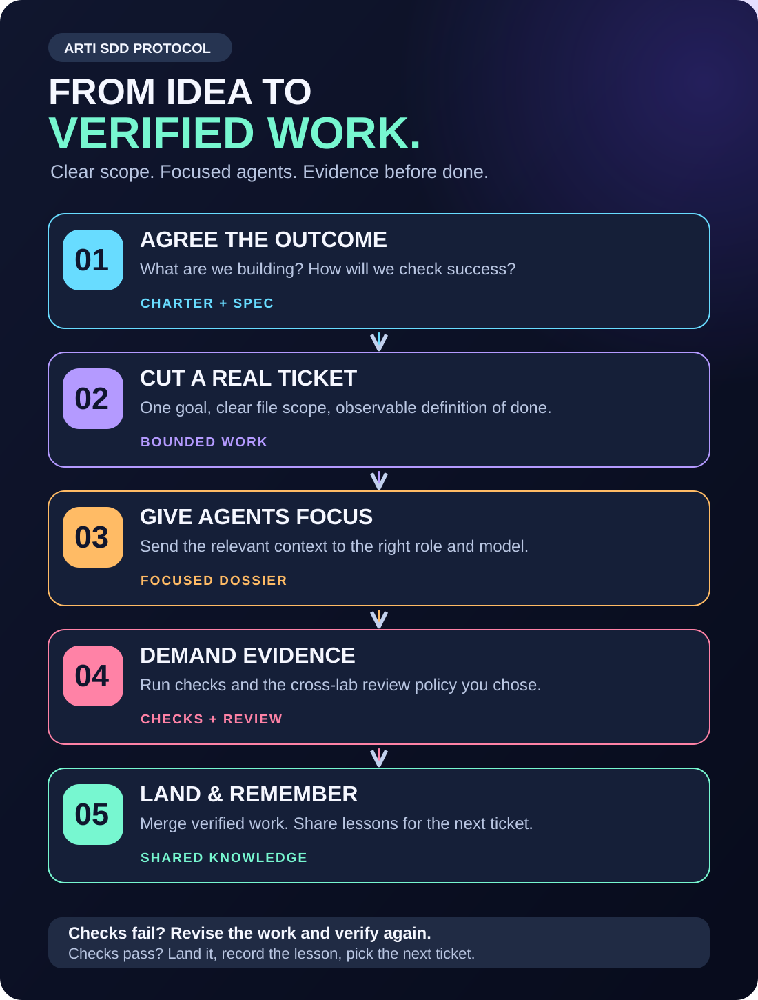

# Arti SDD Protocol

[](https://github.com/elartifice/arti-sdd-protocol/actions/workflows/check.yml)

**Clear specs. Focused agents. Evidence before “done.”**

Arti is a lightweight skill for spec-driven development (SDD). Use it in chat to turn an idea into a portable project blueprint, or give it to a coding agent to start or organise a repository. Claude Code and Codex share instructions and project knowledge. An optional custom team routes focused tasks to explicit models, keeping worker investigations out of the main conversation and reserving expensive reasoning for the work that needs it.

The installable core is 23 files, about 141 KB, with a short entry point and no runtime package dependencies. Detailed guides and qualification tools stay in this source repository.

## What is SDD?

Spec-driven development means agreeing on the intended behaviour and how to recognise success before asking an agent to implement it. The specification becomes the reference for planning, coding and review. It changes when the project changes, with the decision recorded.

Arti turns that idea into a working loop: a charter describes the project; milestones and tickets divide the work; each ticket has a bounded scope and an observable Definition of Done (DoD); checks and the chosen review policy supply evidence before work is closed.



## From vibe coding to work you can follow

Fast experimentation helps you discover what to build. As a project grows, a stream of prompts can also leave moving requirements, forgotten decisions and changes nobody has properly checked. Arti gives that work a durable structure.

| Common problem | What the protocol adds |
|---|---|
| Scope keeps changing between prompts | A charter, specification and recorded decisions that make changes visible. |
| “Done” means the agent says it finished | Ticket-specific DoDs, actual checks and evidence tied to the exact revision being considered for merge. |
| Parallel agents overwrite or duplicate work | Explicit file territory, ownership claims and Git worktrees (separate working directories) for concurrent work. Across separate clones, coordinators still assign disjoint territory. |
| Switching models or starting a fresh chat loses context | Shared rules, a knowledge index and handoffs that preserve the task and existing approval. |
| Claude and Codex maintain different instructions | One shared source, with links or generated adapters for each host. |
| A configured reviewer never actually runs | Explicit dispatch plans, native role qualification and review receipts: records of who reviewed which revision, with completion, findings, failure or “not run.” |
| Every investigation fills the main chat and uses its most expensive model | Focused worker contexts, explicit model/effort bindings and short evidence reports; measure coordination and review overhead too. |
| A new setup overwrites existing project conventions | A preview, owner-content preservation, drift checks and recoverable installation. |

These mechanisms are designed to reduce coordination mistakes and false confidence. Product judgment, useful specifications and meaningful tests still matter. A passing fixture suite does not guarantee bug-free software or general equivalence between models.

## A small team, with a reason for every role

The coordinator owns the plan and decisions. A scout finds facts, an implementer changes scoped files, a reviewer challenges the result, and an escalation role receives a failure dossier after repeated failure. Invoke the roles the task needs; a small change can stay with one agent.

Each worker receives the relevant ticket, file scope, rules, lessons and acceptance checks, then returns a compact result with evidence. The dispatcher resolves the per-host binding before each call and verifies the real child session afterward. Codex desktop receives explicit model and effort arguments with a fresh context; native CLI roles use their generated profile. Detailed investigation stays in its worker context. Cheaper scout/implementation models can reduce cost while stronger review and escalation remain available. Shared role instructions generate Claude and Codex definitions from one source.


Estimated cost from **11,134 recorded requests across 17 historical ticket-linked captures**, priced by model, token type and context tier:

| Local observation | Result |
|---|---|
| Recorded model mix versus Opus/Astra throughout | **57.6% lower** estimated API cost: $1,079.47 versus $2,545.80, a $1,466.34 difference. |
| Claude captures / Codex captures | **1.0% / 73.7% lower**, respectively; individual captures range from 0% to 88.2%. |
| Average worker input per request | **42.1% smaller** than coordinator input in this sample. |

Most cost reduction here comes from choosing Sol for entire Codex threads. Workers usually used the same model as their coordinator; using cheaper worker models contributed only **1.8%** against that narrower reference. The 57.6% figure describes the observed model mix against an all-flagship alternative, not a saving caused by delegation alone. External review costs are incomplete, and API-equivalent costs are not subscription bills. See the [token counts, per-capture results and reproducible calculation](docs/COSTS.md).

Separate contexts help protect the main conversation from noisy logs, but spawning agents adds requests, and a fork may copy existing history. The host's context-window capacity is unchanged. Keep dossiers and return reports short, and measure the whole workload. See the vendor guidance for [Claude subagents](https://code.claude.com/docs/en/sub-agents) and [Codex subagents](https://learn.chatgpt.com/docs/agent-configuration/subagents).

## Start where you are

| Starting point | Ask for | Result |
|---|---|---|
| An idea in chat | A project charter or blueprint | One portable `PROJECT-CHARTER.md`, with architecture, milestones, initial tickets, acceptance evidence and open decisions. No repository tools needed. |
| A new repository | Setup using the charter | The selected shared layout, planning files, rituals and host adapters. |
| An existing repository | An audit and setup that fits its current work | Existing owner rules, skills, tickets and unfinished work are preserved. |

Read the canonical [SKILL.md](.agents/skills/arti-sdd-protocol/SKILL.md), or tell your assistant to read it by its full local path. In chat, provide that file and the charter reference/template it requests.

Example requests:

> Use Arti SDD in chat mode to create a project charter for a local inventory CLI. Include architecture, milestones and initial tickets. Keep unknown choices open and label assumptions that need repository inspection.

> Use Arti SDD to set up this repository from its charter. Preserve existing instructions and work, preview the changes, and implement the setup choices I have authorised.

> Review this existing repository's working protocol. Organise its tickets, shared knowledge and Claude/Codex setup while preserving existing work.

## One shared project contract

Rules live in `AGENTS.md`; skills in `.agents/skills`; role instructions in `.agents/roles`; durable lessons in `.agents/memory`. Claude uses instruction imports or links and shared skill links. Codex discovers the canonical skills. Native role definitions are generated from the shared role sources and per-host bindings.

Shared knowledge records durable lessons with source/date and links to decisions and handoffs. Private vendor histories remain local. Fresh contexts read or receive the relevant project knowledge.

See the [agent setup and review guide](docs/AGENT-SETUP.md) for the file layout, tested models, role DoDs and cross-lab verification.

## Repository setup

Chat planning needs Markdown only. Repository helpers need **Node.js 22+ and Git**. Initialise a new Git repository before applying setup. Native qualification and review use existing Claude Code/Codex CLI logins and quota; the core does not provision API keys.

Settle the charter's merge policy, planning location, hosts, QA depth, team/review policy and board choice. **Cross-lab review has no preselected policy.** Each project chooses required, risk-scoped, opportunistic or disabled review. A draft can leave it undecided; installation requires a settled choice.

From this source checkout, replace the two example paths, then validate and preview:

```sh
arti_skill="$PWD/.agents/skills/arti-sdd-protocol"
arti_target="/absolute/path/to/project"
arti_charter="/absolute/path/to/PROJECT-CHARTER.md"

node "$arti_skill/scripts/schema.mjs" --config "$arti_charter"
node "$arti_skill/scripts/setup.mjs" plan --repo "$arti_target" --config "$arti_charter"
```

After reviewing the plan and authorising setup:

```sh
node "$arti_skill/scripts/setup.mjs" apply --repo "$arti_target" --config "$arti_charter"
node "$arti_skill/scripts/check.mjs" --repo "$arti_target"
```

Review and trust Codex project hooks with `/hooks` before relying on them. `check.mjs --repo "$arti_target" --native codex` inspects native hook trust; a generated hook file alone does not prove enforcement. Use real edit probes when qualifying an integration.

A custom team also needs an explicit `--team` file for both plan and apply. The [dated example mapping](docs/examples/team-2026-11-03.json) reproduces the release profile; it is not a default or proof of access on your account. Follow the [qualification procedure](docs/AGENT-SETUP.md#qualify-your-project) before relying on it.

For a user-level installation, keep one reviewed copy under `~/.agents/skills/arti-sdd-protocol` and link that individual skill from both `~/.claude/skills` and `~/.codex/skills`. Preserve any real directories when creating links. Ordinary project setup does not change global configuration.

## What has actually been verified?

The version 0.4.1 qualification, dated **2026-11-04**, covers macOS 26.6.2 arm64, Claude Code 2.1.310 and Codex CLI 0.166.0:

- All five native roles ran on both hosts with actual invocation/model evidence and role-specific task checks.
- Both review directions passed three security-defect trials, three quantity-calculation-defect trials and a clean control, followed by an actual production author-to-reviewer dispatch.
- Both clients denied actual generic dispatch and conflicting model/effort requests; Codex also denied full-history forks and missing native selectors. Both passed allowed/denied edit probes, persisted-session resumes, fresh cross-host handoffs and chat-only charters.
- All five Codex desktop bindings passed separate real task, native model/effort and fresh-context checks. Native profile selection and independent role-source delivery are unavailable on that surface.
- The deterministic suite passed 82 tests on Node 22.23.4 and 25.8.1, including exported-source checks, real Git races, worktrees, recovery and linked helper execution.

The [native report](docs/QUALIFICATION.md) and [machine-readable evidence](docs/qualification.json) bind those results to the installable package digest. The [validation guide](docs/VALIDATION.md) states their boundaries.

Claude's client exposes requested effort without effective-effort telemetry. Codex custom roles inherit parent permissions; their role files do not create separate sandboxes. Scope hooks cover supported file tools and patches; arbitrary shell writes require final scope verification. Required missing or stale review evidence blocks completion.

Other coding agents can read the shared files and run helpers with explicit manual checks. Other native integrations and Linux/Windows host journeys remain unqualified. Graphical boards, recording, deployment, issue mirrors and backup automation are documented extensions outside this core. The [GitHub Actions matrix](https://github.com/elartifice/arti-sdd-protocol/actions/workflows/check.yml) checks deterministic behaviour on macOS/Linux and Node 22/24; native host qualification remains the separate dated evidence above.

## Contribute and share

See [CONTRIBUTING.md](CONTRIBUTING.md) for local checks and change guidance. The [publication guide](docs/RELEASE.md) contains copy-ready GitHub description, topics, release notes and the remaining publication steps.

MIT; retain the [licence](LICENSE) and required notices. Publication is a separate maintainer action; setup and packaging do not upload anything.
