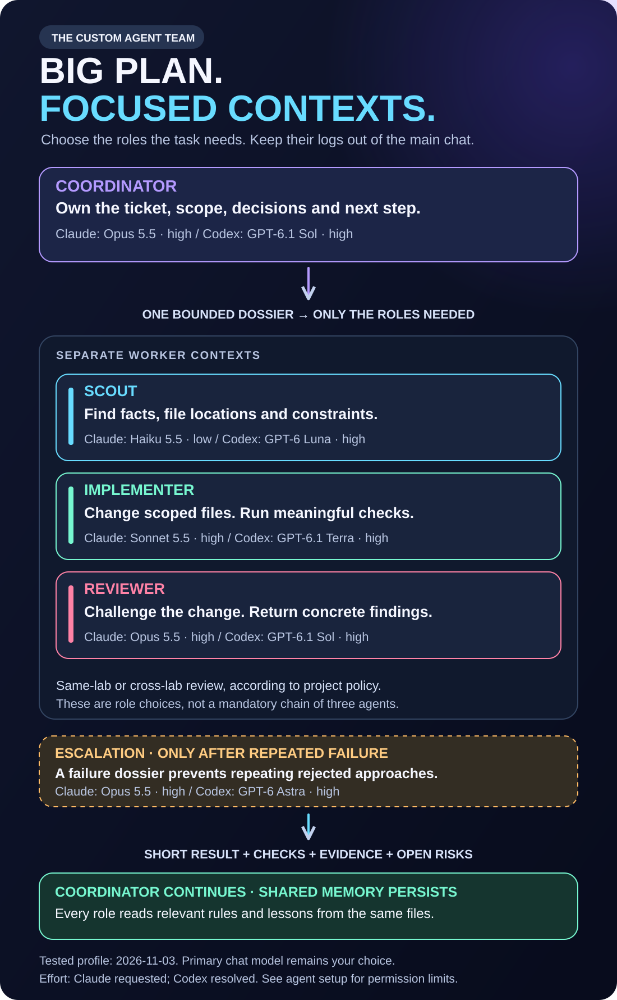
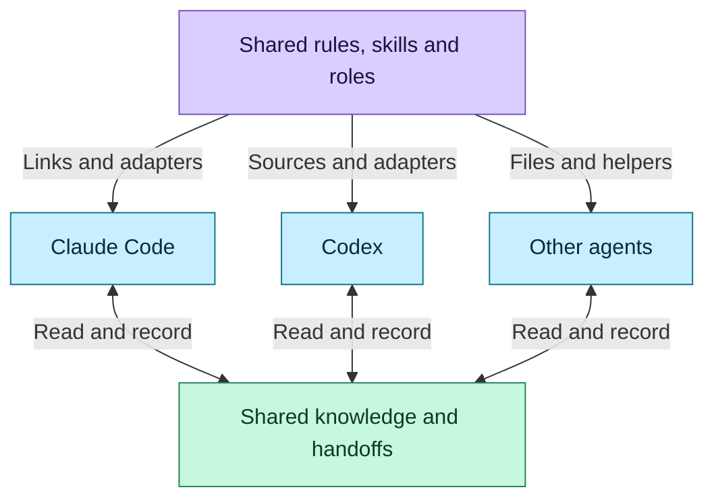
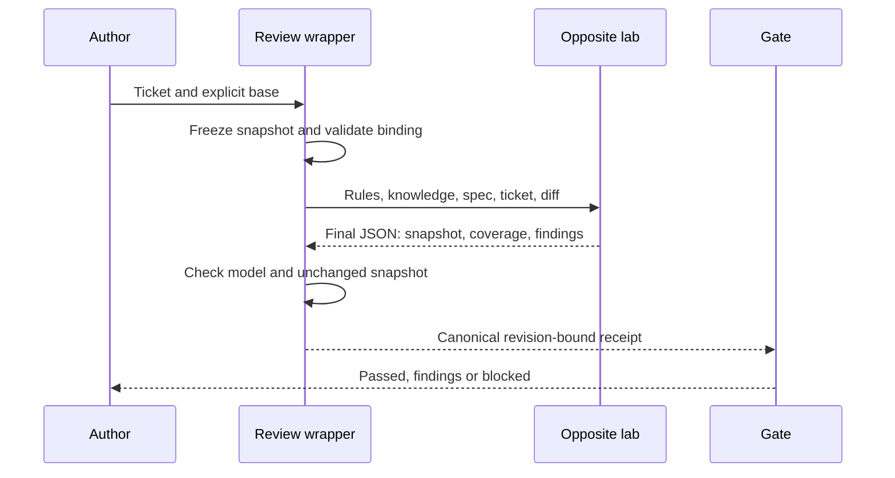

# Claude Code and Codex agent setup

This is the **tested release profile**, dated 2026-11-04, for the exact clients and package in [QUALIFICATION.md](QUALIFICATION.md). Projects choose and qualify their own bindings. The host's primary chat model remains the user's choice; configuring a named coordinator profile does not reset it.

Projects can choose single-agent work. This custom profile enables five roles; ordinary work need not invoke all of them, and escalation is reserved for repeated failure.

## Why split work into custom agents?

A coordinator keeps the ticket, decisions and next step. It gives a worker the relevant spec, file scope, shared lessons and checks, then receives a short result with evidence. Investigation logs stay in the worker context. This keeps the main conversation focused and lets bounded scouting and implementation use cheaper models while preserving stronger review and escalation.



All four subagents report directly to the coordinator. Cyan arrows carry tasks and relevant context down; purple arrows carry results, checks and risks back up. The worker cards are choices, not a required sequence, and escalation is conditional. They do not spawn one another automatically. Same-lab and cross-lab review follow the policy chosen by the project. The named coordinator binding does not override the primary chat model. The ChatGPT/OpenAI mark identifies the provider; its external reviews run through Codex CLI. See [mark sources and attribution](assets/BRAND-MARKS.md).

Separate contexts are an efficiency mechanism, not a token guarantee: spawning adds requests, forks can inherit history, and long handbacks add context. The [expanded local study](COSTS.md) prices 11,134 requests across 17 historical captures. The observed model mix is 57.6% below an all-Opus/Astra alternative; worker inputs average 42.1% smaller. Most cost reduction comes from whole-thread model choice. The narrower worker-versus-coordinator price comparison saves 1.8%, because most historical workers inherited the coordinator's model. These older workflows do not benchmark the released role profile; the study states coverage and external-review gaps.

## Models and effort per role

| Named role | Claude effective model | Requested effort | Codex effective model | Resolved effort |
|---|---|---|---|---|
| Coordinator | `claude-opus-5-5` | `high` | `gpt-6.1-sol` | `high` |
| Scout | `claude-haiku-5-5` | `low` | `gpt-6-luna` | `high` |
| Implementer | `claude-sonnet-5-5` | `high` | `gpt-6.1-terra` | `high` |
| Reviewer | `claude-opus-5-5` | `high` | `gpt-6.1-sol` | `high` |
| Escalation | `claude-opus-5-5` | `high` | `gpt-6-astra` | `high` |

The [example team file](examples/team-2026-11-03.json) records separate bindings for each host, with `max_concurrent: 2`. The tested Claude requests use `opus`, `haiku` and `sonnet` aliases, while `effective_model` pins the observed IDs above. A changed alias resolution must be requalified. Codex uses explicit model IDs. Neither vendor's tier names nor effort labels establish equivalence.

Claude child messages or a correlated native completion record, together with first-party model usage, established the actual model/provider. Its client did not expose effective effort: the report records the requested setting and `effort_verified: false`. Codex native activity and child-thread metadata supplied the role identity, model/provider and resolved effort. An “OK” response alone was insufficient.

## Each role has an observable Definition of Done

| Role | What the native fixture had to prove |
|---|---|
| Coordinator | Choose dependency-ready work and reject an incomplete required review; retrieve the shared lesson; make no product edits. |
| Scout | Locate two seeded source facts with correct values and file/line evidence; retrieve shared knowledge; leave product files unchanged. |
| Implementer | Fix quantity multiplication and the positive-number filter within the assigned source file; retain the assertions and pass the actual command. |
| Reviewer | Identify both the ownership-check defect and the quantity-calculation defect; cite the files; retrieve shared knowledge; make no product edits. Repeated external trials also require clean controls. |
| Escalation | Fix null handling and numeric-zero handling from a repeated-failure dossier; avoid rejected approaches, preserve assertions and stay within the assigned source file. |

For the native inheritance control, each parent uses a different model and requested effort from the tested child. Codex native metadata must resolve to the child setting; Claude still has no effective-effort telemetry.

Every enabled role also had to be discovered and actually invoked through its native custom-agent mechanism. Generated files alone did not satisfy the gate. These bounded fixtures establish suitability for those tasks, not a general model benchmark.

## Dispatch the configured role

A generated agent file does not route a generic worker. Prepare every delegation with the installed `scripts/dispatch.mjs plan` helper, using a private task file and explicit assigned paths for writable roles. Execute its emitted tool arguments and verify the child with `dispatch.mjs verify` before accepting its result. The helper refuses missing bindings and stale adapters.

| Surface | Dispatch | Observable proof |
|---|---|---|
| Claude Code | Native `Agent` selects `arti_<role>`, with the required description and exact dossier. | Actual Agent call, child message or correlated completion model, and first-party model usage. Effort is the native role setting; effective effort is unavailable. |
| Codex CLI | Native `spawn_agent` selects `agent_type: arti_<role>`, a unique task name and fresh context. | Child native role identity, model/provider and resolved reasoning effort. |
| Codex desktop | `collaboration.spawn_agent` receives explicit `model`, `reasoning_effort`, `fork_turns: none`, unique task name and the full shared role source plus bounded dossier. | Child model/provider and resolved effort. This API has no named-profile selector; native role identity is labelled unsupported. Shared role text is sent in the planned argument, but its sealed delivery is not independently observable. |

Use a canonical real path for Codex project trust; an aliased path can leave project roles undiscovered. The dossier includes the absolute repository path, current scope/approval and assigned files. Preserve exact allowed test commands, including restrictions on compound shell commands. A fresh fork carries no prior conversation, so include the relevant decisions and knowledge explicitly.

Codex seals dispatched message text in its stored tool call. The Codex evidence file contains only `{ "threadId": "<native-child-id>" }`; the checker fetches native state itself and refuses supplied thread/rollout JSON. Claude checks a trusted local stream log, without a signed-attestation claim. Verification correlates the unique native child path and parent ID with a dispatch marker in the child's final report, then checks model and effort independently using native metadata. The marker is not model evidence. Claude evidence retains the exact Agent prompt. These are trusted local receipts, not signed attestations.

The [separate desktop qualification](desktop-qualification.json) records five actual role tasks with native model/effort evidence, protected checks and assigned-scope verification. Its native profile identity remains unsupported.

Supported native hooks deny generic role requests and conflicting model/effort overrides; the live suite checks actual hook denials on both clients. Desktop hook coverage is not claimed: that route requires explicit arguments and the post-execution check. Codex roles inherit parent permissions on both surfaces; a role label or fresh context does not create a smaller sandbox.

## Shared sources and host adapters



An installed project's relevant files are:

```text
AGENTS.md                       Shared rules
CLAUDE.md                       Link to AGENTS.md, or import preserving owner text
.agents/skills/                  Canonical protocol and ritual skills
.agents/roles/                   Shared role instructions
.agents/team.json                Explicit per-host model/effort bindings
.agents/memory/INDEX.md          Shared knowledge index
.agents/memory/<topic>.md        Durable lessons with source/date
.claude/skills/arti-*/           Links to individual shared skills, or safe directory link
.claude/agents/arti_*.md         Generated Claude definitions
.codex/agents/arti_*.toml        Generated Codex definitions
arti_sdd/                       Decisions, specs, tickets and handoffs
```

Edit canonical sources and regenerate managed adapters through setup. Preserve unrelated owner files. Private host histories are not a shared memory database. New sessions and delegated work read or receive the relevant shared knowledge. Both fresh handoff directions were tested by recovering a newly written ticket key, next step and approval from shared files.

Claude supports sharing `AGENTS.md` through an import or symlink, subject to host settings and platform constraints; Arti preserves this explicit bridge. See [Claude project memory](https://code.claude.com/docs/en/memory#share-one-file-with-other-coding-tools). Codex custom agents inherit their parent's permissions, provider and MCP configuration; see [Codex subagents](https://learn.chatgpt.com/docs/agent-configuration/subagents).

## How both cross-lab directions were verified

| Author host | Actual external reviewer | Required-policy quality trials | Production dispatch |
|---|---|---|---|
| Claude Code | Codex, `gpt-6.1-sol`, `high` | Security defect 3/3; quantity defect 3/3; clean control 1/1 | Claude's native Bash tool ran the wrapper once; a completed production receipt passed. |
| Codex | Claude, `claude-opus-5-5`, requested `high` | Security defect 3/3; quantity defect 3/3; clean control 1/1 | Codex's native shell tool ran the wrapper once; a completed production receipt passed. |

That is **14 quality trials and two production dispatches**. Each defect trial required a concrete major/blocking finding on the changed file. Each clean control required no findings. Trial snapshots were distinct; incomplete coverage was a failure.

The production dispatches tested the real author CLI invoking the wrapper with an imported matching qualification record. Private tool traces additionally confirmed exactly one canonical command execution per author. The parent's answer was not used as the external review. The primary session model used to dispatch a command is independent of the named role table above.



Both leaf reviewers ran outside the candidate tree with no repository or connector tools. Claude used safe mode with an empty tool/MCP surface. Codex ignored user configuration and rules, disabled repository/connector capabilities and used a read-only process. Native client metadata established the expected model and provider. The wrapper retained the receipt in private runtime state; the candidate stayed clean.

Regression tests reject missing CLI/authentication/model evidence, malformed bindings or final output, startup chatter, quoted JSON from a tool, missing base, dirty/untracked or oversized candidates, incomplete coverage and stale receipts. Required review fails closed: missing or invalid evidence blocks completion. Opportunistic or disabled policies remain honestly labelled. These policies are project choices with no preselected default.

## Permissions and operational limits

- Codex read-only native roles were qualified under a read-only parent. A custom role's prose does not create a separate sandbox. Use the restricted external reviewer from a writable coordinator.
- Codex workspace mode protects `.agents` and Git metadata. Setup returns scoped launch arguments for authorised shared-memory updates and private runtime records. The author-to-reviewer route also needs network access; the leaf reviewer remains restricted.
- Claude edit permission does not automatically authorise shell test commands. Qualify the actual commands and preserve native denials.
- Both hosts passed actual allowed/forbidden edit probes. Hooks cover supported edit tools and patch inputs; arbitrary shell writes still require candidate scope verification.
- Codex project hook definitions need review and trust through `/hooks`. The native checker reports trust separately from generated configuration; qualification uses actual allowed and denied tool calls.
- Codex's native concurrency cap is configured from the shared team value. Claude definitions carry turn caps; coordinator guidance controls other scheduling limits rather than claiming the same native enforcement.
- Qualification uses existing CLI authentication and quota. This Codex version needs persistent parent sessions for native custom-agent spawning; test sessions remain for the owner to manage.

## Qualify your project

Use the [example mapping](examples/team-2026-11-03.json) as a dated starting point after confirming model access. Set the charter's team to `custom`, settle review policy explicitly, and supply the mapping with `--team` to both setup plan and apply.

From this public source repository, test the installed project's exact role sources and bindings in disposable fixtures:

```sh
node dev/qualify.mjs --target /absolute/path/to/project
```

After reviewing a passing report, import it with the installed helper and check qualification:

```sh
arti_project="/absolute/path/to/project"
arti_report="/absolute/path/to/trusted/passing/report.json"
node "$arti_project/.agents/skills/arti-sdd-protocol/scripts/team.mjs" --repo "$arti_project" --evidence "$arti_report"
node "$arti_project/.agents/skills/arti-sdd-protocol/scripts/team.mjs" --repo "$arti_project" --require-live
```

Changing role sources, bindings, expected model, effort, package or client version invalidates matching evidence. Requalify after access/credential changes. These are trusted local records, not signed independent attestations. The release report proves the recorded release fixtures; it does not certify another account or platform automatically.

See [VALIDATION.md](VALIDATION.md) for the rest of the matrix and [RELEASE.md](RELEASE.md#remaining-gaps-and-publication-actions) for publication gaps and support boundaries.

Claude can omit unplanned Agent arguments from the PreToolUse hook input even when they appear in the recorded call. In a native `resume` probe, the hook did not prevent the call; the dispatch verifier rejected the recorded arguments after dispatch. Do not treat this as pre-execution enforcement. Verify the native call record before accepting the child result.
