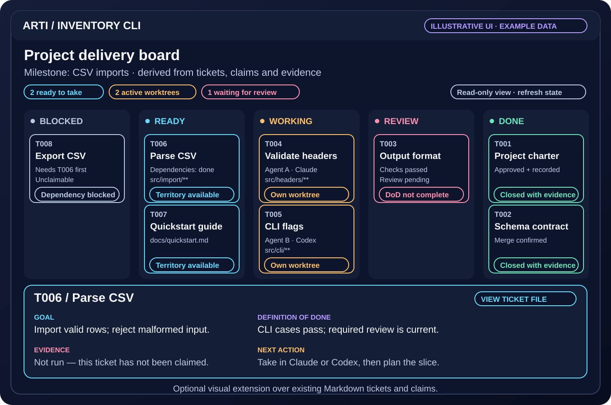

# A board for the ticket loop

A board makes the protocol visible: what is ready, what is blocked, who owns each active ticket, which files may change, and which evidence is still missing. It helps a human coordinate Claude and Codex without reading every worker transcript.

The core supports **Markdown tickets or authoritative GitHub Issues**, chosen during setup. The optional GitHub Projects adapter supplies a persistent hosted portfolio without a local server. Private claims, approvals and verification evidence remain separate from board presentation. The illustration below is a design example, with fictional data, for that optional extension.



## A persistent GitHub board

Select `planning: "github"`, `board: "github"`, and an explicit `tracker.repository` during setup. Keep existing planning intact for owner-led reconciliation. Issue bodies hold a structured ticket contract plus the readable goal and DoD; local Git stores an immutable owner-approved snapshot before a claim. There is no Markdown issue-status mirror or status-only PR.

From this source distribution, create a private Project once:

```sh
node extras/github/board.mjs create --owner YOUR_LOGIN --title "Project delivery" --authorization "Owner selected hosted board"
```

Save the returned URL in `tracker.project_url` and bookmark it. Reuse it across sessions. To add existing issues, supply exact repository and issue lists:

```sh
node extras/github/board.mjs sync --url https://github.com/users/YOUR_LOGIN/projects/1 --repositories '["YOUR_LOGIN/project-a","YOUR_LOGIN/project-b"]' --issues '["https://github.com/YOUR_LOGIN/project-a/issues/7","https://github.com/YOUR_LOGIN/project-b/issues/7"]' --authorization "Owner selected these portfolio issues"
node extras/github/board.mjs inspect --url https://github.com/users/YOUR_LOGIN/projects/1
```

The two issue number 7s remain different records. The helper reads authoritative Issues, adds only the selected cards, checks readback and preserves unrelated content. After a successful API response, delayed card visibility gets at most three read-only retries (200 ms, 500 ms and 1 second); those reads never repeat the add mutation. Missing cards after that bound remain unverified. Authentication, permission, network and other API failures stop immediately. Projects access is needed in addition to repository access; missing scope/network fails visibly. No extra repository access is requested implicitly. A new Project is private by default; public visibility needs a separate owner decision. Inspect existing Projects after a lost create response rather than creating duplicates.

This hosted URL survives agent exits and ticket changes. It does not depend on a terminal server. Native GitHub views can group by status/repository/milestone. Add new issues explicitly or select a GitHub auto-add workflow; the adapter does not silently install automation. Inspect the new Project’s GitHub-provided default workflows as well: remove or disable automatic issue closing from card moves and any unselected auto-add rules. Status updates may follow Issue/PR events, but moving a card must not close authoritative work. A closed issue or moved card is not verified completion. Claim/check/review/merge gates remain in force. Missing remote state stays unavailable, never silently replaced by stale cached authority.

## Start with a small Markdown view

A coding agent can summarise the authoritative ticket files without a server or frontend. For example:

| Ticket | Goal | Dependencies | Territory | Current next step |
|---|---|---|---|---|
| T006 | Parse CSV | T002 done | `src/import/**` | Available to claim |
| T007 | Quickstart guide | None | `docs/quickstart.md` | Available to claim |
| T008 | Export CSV | T006 unfinished | `src/export/**` | Wait for T006 |

This is fictional example data, not installer output. Refresh the view from the files and active claims; readiness is not an independent manually maintained truth. A graphical board can make the same information easier to scan.

## What each view means

| View | Derived meaning | Useful information |
|---|---|---|
| Blocked | An explicit blocker, unfinished dependency or conflicting claim prevents taking the ticket. | The blocking ticket, file territory or decision; a missing check remains unknown. |
| Ready | Dependencies are done and the ticket is available to claim. | Goal, milestone, priority, dependency links and approved territory. Readiness must be rechecked when claiming. |
| Working | A live ownership claim identifies the responsible session/worktree. | Agent/host, role, assigned territory and latest handoff. Disjoint tickets can run concurrently. |
| Review | Implementation is ready for the required checks/review or merge confirmation. | Definition of Done, exact candidate revision, actual command receipts, reviewer findings and missing evidence. |
| Done | Verification and the project's landing policy have completed. | Confirmed merge, final evidence, shared lesson and released claim. |

These are presentation columns, not a new competing status database. A project adapter should derive them from its actual ticket states, dependencies, claims and receipts. A green card cannot substitute for those records. Across separate clones, coordinators still need to assign disjoint territory; remote ticket-ID ownership alone does not prove file scopes do not overlap.

## Keep ticket details close

A simplified ticket card contains its goal, dependencies, allowed file paths, observable Definition of Done and evidence links. An expanded view can show the active owner, blockers and review status. If routing information is displayed, distinguish configured settings from actual native verification; Claude's effective effort is unavailable in the qualified client.

Useful controls are read-only: open the ticket, show its dependency chain or copy the selected host's supported command. For example, a human can start a conversation with `/arti-grab-ticket T006` in Claude Code or `$arti-grab-ticket T006` in Codex. The agent still performs the real claim and territory checks. A board should not manufacture ownership, launch arbitrary shell commands or invent host deep links.

## Ask an agent to add the visual extension

> Build a small, read-only local board over this repository's existing ticket and claim records. Preserve their authority. Show blocked, ready, working, review and done views, a dependency explanation, territory and owner, and the evidence still needed. Use the selected host's supported take-ticket command. Serve a sanitised projection on loopback, label missing/stale data honestly, and verify it with representative ticket fixtures before calling it complete.

Keep `board: markdown` when choosing the local Markdown route; choose `board: github` only with GitHub planning. Add the visual view as a normal project ticket; selecting an unimplemented graphical module in the installer is an explicit unsupported result. The visual view does not require a web framework or extra context in the installed skill.

Its acceptance checks should demonstrate:

- A refreshed view reflects a finished dependency or new claim. The real claim operation rechecks readiness and ownership even when a displayed card is stale.
- Two independent territories can be active together; overlapping scopes and duplicate ticket claims are refused by the real coordinator/claim workflow.
- Missing or stale checks/review remain visibly incomplete. A closed card follows confirmed landing, not an agent's success message.
- Reloading preserves authoritative state, and refresh failures show stale/unknown data rather than fabricated zeroes.
- The server binds to loopback and serves an allowlisted, sanitised projection. Private transcripts, secrets, raw agent state and unrelated repository files are not exposed.

This keeps the board useful for coordination while the ticket contracts, native tools and evidence continue to govern delivery.
